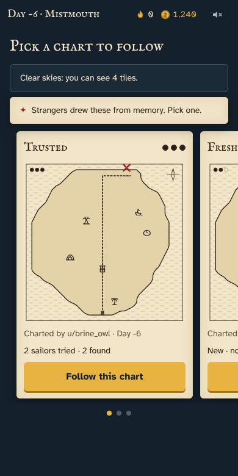
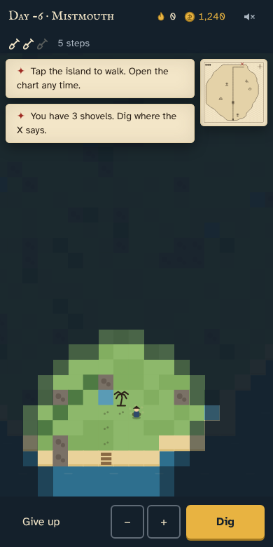
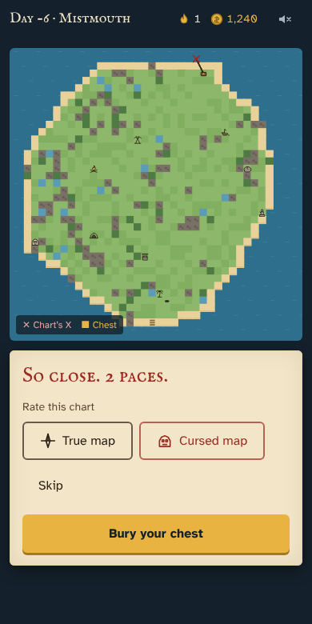
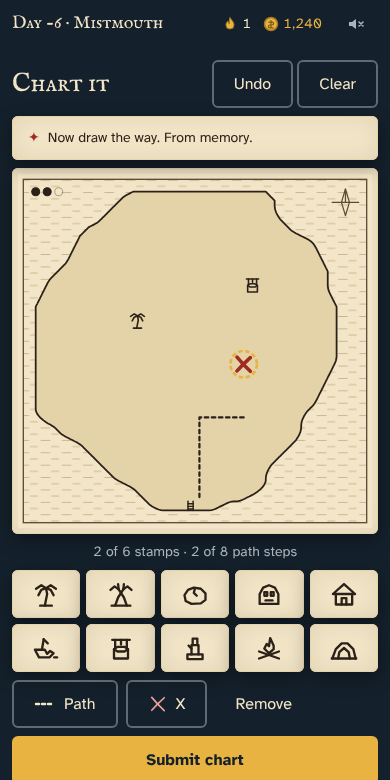

# Isle of Maybe

**Bury it. Chart it. Trust a stranger's map.**

A daily treasure-map game that runs inside Reddit posts. Every day there's a new island. You follow a map another player drew from memory to find their buried chest. Then you bury your own and draw a map for the next sailor. Tomorrow, you find out how many sailors your map led to gold.

> Built for Reddit's Game of the Day Hackathon (Nov–Dec 2026) on Reddit's Developer Platform (Devvit Web).
> Status: feature-complete on the server and client; playtesting next. See [the plan](docs/README.md) and [the specs](specs/README.md).

<p>
  
  
  
  
</p>

## How to play
1. Tap **Set sail** on today's island post.
2. Pick a chart: **Trusted**, **Fresh**, or the **Old Captain's**.
3. Tap the island to walk. Open the chart any time. You have **3 shovels**: dig where the X says.
4. Rate the chart: **True map** or **Cursed map**.
5. **Bury your chest** on a spot you've seen. Far from landmarks is **Deep**, which pays more to you and to whoever finds it.
6. **Draw your chart from memory**: up to 6 landmark stamps, a dotted path of up to 8 steps, and one X.
7. Get your **Ink check** now. Come back tomorrow for your **Dispatch**: how many sailors tried your chart and how many found your chest.

You can hunt up to 3 charts a day and bury 1 chest. Good charts rise; great chartmakers earn tiers from Deckhand to Legend of the Isles.

## For moderators
- Install the app in your subreddit. A new island post appears every day at 00:00 UTC with a sticky comment for chart shares.
- Mod menu: **Post today's island** (if a post is missing), **Review reported charts** (restore or delete), **Re-run daily job**.
- Players can report charts. A chart with 3 reports is hidden until a moderator reviews it.
- Charts are made only from a fixed set of symbols (no text, no freehand drawing) and always show their author.
- Sharing a chart as a comment is optional and always asks first. All player content expires after 30 days.

## Development
```bash
nvm use            # Node 24 (see .nvmrc)
npm install
npm run login      # Devvit login (once)
npm run dev        # playtest in r/IsleOfMaybe_dev
npm run test:unit  # tests
npm run deploy     # type check + lint + upload
npm run build && npm run preview:local   # the real API on an in-memory store, at localhost:5180
```
- How we work: [`AGENTS.md`](AGENTS.md) and [`specs/README.md`](specs/README.md) (spec → issue → PR → merge).
- Product, design and architecture: [`docs/`](docs/README.md).

## Credits
Fonts: IM Fell English SC and Atkinson Hyperlegible (SIL Open Font License). Inspired by small map-drawing games such as *Captain Peggles: That Man's Chest*. Built from Reddit's Devvit React template (BSD-3-Clause). Game code, art and writing made for this hackathon by Harsh Bhanushali.
